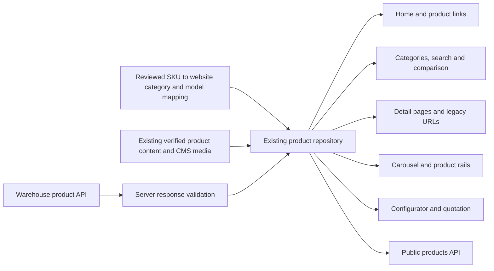
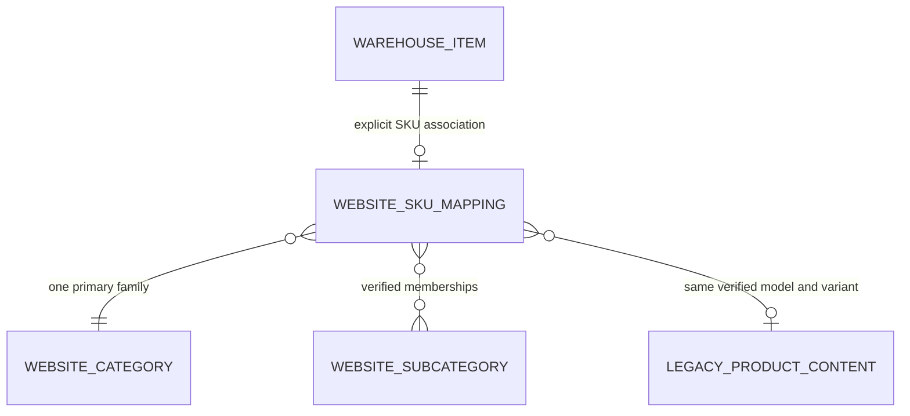

# Warehouse products across the SUNFORD website

Date: 2026-11-10
State: implemented and production-browser verified; 89 preferred G SKUs enabled, 291 records parked by the owner's explicit instruction.

## Current implementation

The source audit below records the earlier investigation. Its missing-input and approval gates have been resolved by the configured API/CMS connection and the owner's instruction to publish clear G-prefix matches while parking all other records. Runtime details, current contracts and verification are in [runtime-integration-delivery.md](./runtime-integration-delivery.md); every upstream SKU is accounted for in [runtime-product-status.csv](./runtime-product-status.csv). No Warehouse data or environment credentials were changed.

## Confirmed requirements

The owner wants actual Warehouse products in every product-consuming part of the official website, classified under its existing categories. This supersedes the quotation-only implementation scope. Stock quantity does not control visibility or quotation eligibility. The owner confirmed that Warehouse `sale_price` excludes VAT 7%.

The website currently has five primary categories and 23 subcategories:

| Category             | Existing subcategories                                                                                                 |
| -------------------- | ---------------------------------------------------------------------------------------------------------------------- |
| เครื่องชั่ง          | คำนวณราคาหน้าร้าน, อุตสาหกรรมงานผลิต, วิเคราะห์ความแม่นยำสูง, ครัวและกาแฟ, กันน้ำและกันฝุ่น, ตั้งโต๊ะ, ตั้งพื้น, มีเสา |
| อินดิเคเตอร์แท่นชั่ง | LCD, LED, กันน้ำ                                                                                                       |
| โครงสร้างแท่นชั่ง    | เหล็กคาร์บอน, SUS304, SUS201, ABS                                                                                      |
| ระบบ POS             | iOS, Android, Windows                                                                                                  |
| อุปกรณ์เสริม         | จอและระบบต่อพ่วง, สายและหัวต่อ, อุปกรณ์เคลื่อนย้ายและชิ้นส่วน, POS, วัสดุสิ้นเปลือง                                    |

The IDs and destinations already exist in `mock-categories.ts`, `scale-subcategories.ts`, `indicator-subcategories.ts`, `platform-subcategories.ts`, `pos-subcategories.ts`, `accessory-subcategories.ts` and the subgroup-page definitions. Their names do not imply that every Warehouse SKU has a proven membership.

## Verified source boundaries

| Source                        | Evidence                                                                                                                                                                                                         | Limitation                                                                                                                                                                         |
| ----------------------------- | ---------------------------------------------------------------------------------------------------------------------------------------------------------------------------------------------------------------- | ---------------------------------------------------------------------------------------------------------------------------------------------------------------------------------- |
| Existing official-product API | Earlier same-session GET of configured `/api/store/products`: HTTP 200; 380 unique SKUs; all 380 positive prices; 75 nonempty image fields                                                                       | Only `sku`, `product_name`, `unit`, `sale_price`, `image_url`; no category, model, specifications or publication contract                                                          |
| Current `.env.local`          | Subsequent read found `WAREHOUSE_API_URL` absent; configured PostgreSQL remains Warehouse                                                                                                                        | The earlier API response cannot currently be refreshed through the configured helper; website CMS also needs its own compatible database                                           |
| Website snapshot              | 159 product records with existing content, source IDs, URLs and classification evidence                                                                                                                          | Historical metadata can enrich a proven SKU match, but cannot establish current Warehouse membership or price                                                                      |
| Warehouse master data         | Read-only schema/query inspection found `master_item_group` and active saleable positive-price rows grouped as SCALE, COMPONENT, CONSUMABLE, POS_SYSTEM, PACKAGED_PRODUCT, PERIPHERAL, PRINTER, SAFETY and OTHER | These operational groups do not supply the site's 23 subcategories. This query returned 267 rows; its filters/source are not proven equivalent to the earlier 380-row API response |

API availability and response counts above describe the observations at their respective times, not a continuously verified service. No Warehouse write was performed.

## Consumer audit

| Website area                                   | Current source/path                                                                                                       | Required integration                                                                                                                                            |
| ---------------------------------------------- | ------------------------------------------------------------------------------------------------------------------------- | --------------------------------------------------------------------------------------------------------------------------------------------------------------- |
| Home product selections and product links      | Home route calls `getProducts()`; feature panels match existing product IDs/source handles                                | Keep mapped public IDs/source handles and supply the shared Warehouse-derived catalog                                                                           |
| Product categories, subcategories and counters | `getProductCategories()` and `getCatalogPage()` combine `getProducts()` with legacy memberships and named model manifests | Make explicit SKU category/subcategory memberships authoritative; preserve existing destinations                                                                |
| Search and comparison                          | Request-shared `getClientProducts()` projects `getProducts()` for layout/page consumers                                   | Project the same catalog objects; do not create a second product list                                                                                           |
| Product detail, metadata and related products  | `getProduct()`/`getProducts()` plus source content and CMS media                                                          | Resolve mapped legacy URLs; retain content only for the verified same model/variant                                                                             |
| Legacy collection/product paths                | Catch-all route and `findCatalogProduct()`                                                                                | Preserve existing aliases without returning an item absent from the Warehouse-backed catalog                                                                    |
| Products carousel                              | Imports a fixed 36-product JSON directly in a Client Component                                                            | Resolve approved carousel selections against current shared products on the server; pass live data as props; guard zero/one-item cases                          |
| Products index sections 02–09                  | Eight mock card rails with image/content placeholders                                                                     | Proposed revision: replace with five real category rails using existing card geometry and category links; owner review is required for the section-count change |
| Configurator                                   | `getWeighingOptions()` matches legacy models/names; compatibility comes from the supplied pairs                           | Bind options through explicit SKU/model mappings while preserving verified compatibility                                                                        |
| Quotation                                      | Reads CMS catalog prices and currently assumes VAT-inclusive unit prices                                                  | Use Warehouse net unit price, VAT 7%, returned unit and resolved SKU; keep ambiguous items pending                                                              |
| Public products API                            | `/api/products` delegates to `getProducts()` and returns 503 on failure                                                   | Expose the same public product set, with no internal upstream errors                                                                                            |

## Proposed minimal data flow

Use the current repository as the shared entry point. No new database, service or dependency is proposed.

Warehouse owns product identity, name, unit and net sale price. The reviewed mapping owns association to the existing website category IDs, model codes, legacy IDs/slugs and approved presentation metadata. CMS remains responsible for existing website content. Mapping is an association, not permission to invent a product or specification.

This is a logical interface diagram; it does not propose creating Warehouse tables or database relations. SKU collisions, multiple business variants and a complete kit versus a bare platform must be resolved explicitly. Normalizing punctuation or finding a model name inside a bundle title is candidate discovery, not an approved product match.

## Price contract

Warehouse prices are net of VAT. Quotation lines use net integer satang; document VAT is rounded once from the net document total at 7%, and gross is net plus VAT. Public price presentation can preserve the owner's earlier VAT-inclusive website convention by deriving a gross unit price; retain the original net value separately for quotations. A 100.00-baht net item at quantity 2 gives net 200.00, VAT 14.00 and total 214.00. Zero/missing prices do not remove a real catalog product; they disable automatic pricing for that quotation line.

## Required inputs and review gates

1. Restore `WAREHOUSE_API_URL` and the compatible website `DATABASE_URL` locally. Keep credentials out of tracked files and chat.
2. Identify authoritative category/model information in an existing API, or confirm a reviewed website SKU mapping as the source of those associations. Prepare a coverage report for every API SKU before switching the shared repository.
3. Resolve public-product eligibility and ambiguous variants from actual source evidence. The Warehouse operational groups alone cannot determine SUNFORD website membership.
4. Review the expanded concrete file plan, including replacing eight mock rails with five category rails. The previous quotation-only approval does not cover this wider implementation.

## Verification and reversibility

Before switching the shared repository, verify SKU uniqueness, mapping completeness, category membership, URL/ID preservation and absence of fabricated content. Test upstream failures and updates, all five category families, search, comparison, detail/legacy paths, carousel gestures, configurator and quotation arithmetic/printing. Use mobile, tablet and desktop browser checks plus the project's type/lint/build commands.

The shared catalog is R1 because an incorrect join affects every public product consumer. Implement the boundary and mappings first; switch repository consumers only after coverage passes. Revert the owned application delta and mapping to recover the earlier source. No Warehouse migration, stock write, database credential replacement, commit, push or deployment is included in this audit.
